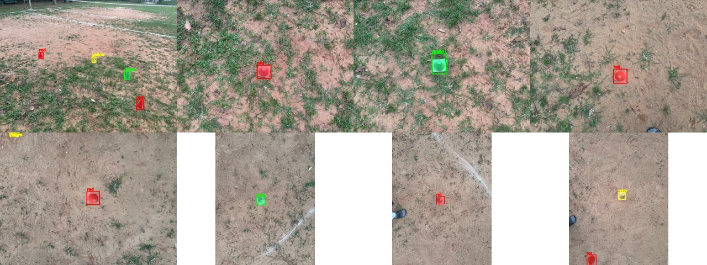
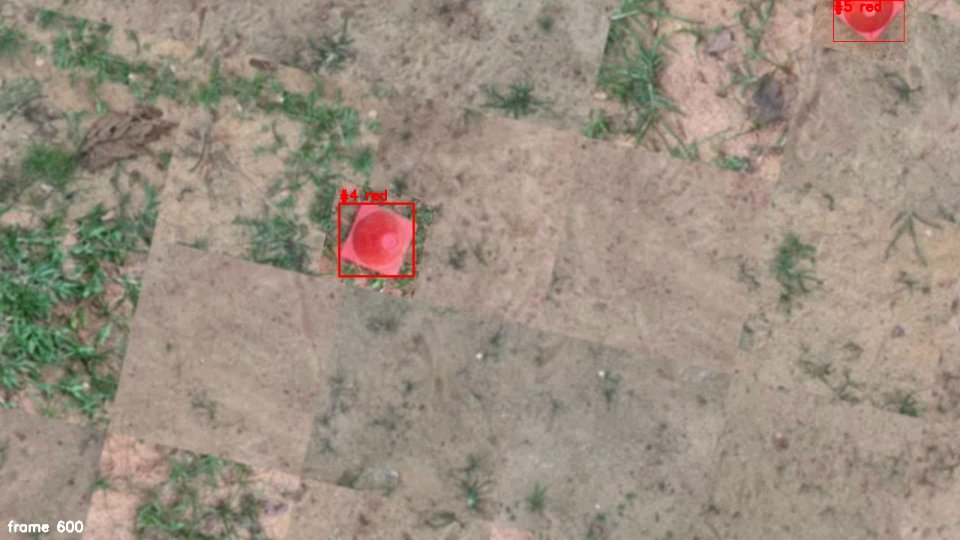
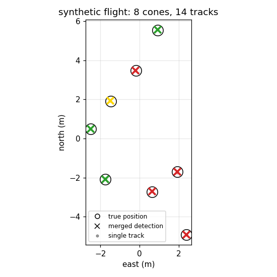

# cone_detection

Finds red, yellow and green cones in the downward camera video from our NIDAR
drone after a flight, and works out each cone's GPS position from the flight
controller's telemetry log. It's all classical CV (HSV thresholds and a small
tracker) with no ML, because I wanted something that works on day one
without a labelled dataset. It also writes YOLO labels, so it can bootstrap
one later.



## How it works

- **`cone_threshold.py`** does the per-frame detection:
  - HSV masks for each colour, then a few checks on each blob: size (0.04% to
    5% of the frame), fill ratio, aspect ratio and the blob's *median* colour.
  - The median check is what separates red cones from skin (median hue 7-9
    vs 176-2) and green cones from grass (grass is much less saturated).
  - The cone also has to be at least 20 saturation points above the ring of
    ground around it.
  - It also runs on still images and can write YOLO `.txt` labels.
- **`detect_cones_video.py`** runs that detector on every frame and links
  detections into tracks with a nearest-centroid tracker. A track needs 5
  hits to count, which removes one-frame colour noise.
  - With `--telemetry`, every detection is geotagged.
  - Tracks of the same colour that land within 1 m of each other get merged,
    so a cone seen again on the next pass is reported once.
- **`geotag.py`** has three parts:
  - **Telemetry parser:** reads the `fc_telemetry_*.log` our mission logger
    writes.
  - **Camera model:** a nadir pinhole (61.4 deg HFOV for the LifeCam) using
    altitude above home and heading.
  - **Merging** of revisited cones.
- **`make_synthetic_flight.py` + `compare_truth.py`** are how I tested the
  geotagging without a real flight (see below).

## Running it

Tested with Python 3.12, OpenCV 4.6 and NumPy 1.26.

```bash
pip install -r requirements.txt

# still images: print detections, save annotated copies and YOLO labels
python3 cone_threshold.py sample_images/*.jpg --vis-dir out/vis --label-dir out/labels

# flight video + telemetry
python3 detect_cones_video.py flight_2026-10-05_20-42-49.mkv \
    --telemetry fc_telemetry_2026-10-05_2015_to_2026-10-05_2045.log
```

The video run writes `<video>_cones/`, which contains:
- `cones.json`: tracks, plus the merged unique cones with lat/lon
- `cones.geojson`: drop it onto geojson.io
- `detections.csv`
- `crops/`, with the best crop of each track
- `annotated.mp4`

Without `--telemetry` it only detects and tracks. The video start time comes
from the `flight_YYYY-MM-DD_HH-MM-SS` filename.

`sample_images/` has 8 photos I took of the cones on the ground (640x480,
roughly top-down). The thresholds were tuned on these.

## Testing the geotagging

I didn't have a daytime flight over cones, so I faked one.
`make_synthetic_flight.py` does four things:
- It builds a ground texture out of cone-free patches from my photos.
- It pastes 8 cone sprites at known GPS positions along the path we actually
  flew on 5 Oct.
- It renders what the camera model would see at every telemetry pose.
- It saves the true positions to `truth.json`.

```bash
python3 make_synthetic_flight.py sample_images fc_telemetry_....log syn \
    --start "2026-10-05 20:42:49" --duration 143
python3 detect_cones_video.py syn/flight_2026-10-05_20-42-49.avi \
    --telemetry fc_telemetry_....log --out-dir syn_out
python3 compare_truth.py syn/truth.json syn_out/cones.json
```

```
found 8/8, false positives 0, error mean 0.01 m, max 0.03 m
```

All 8 found, no false positives, and the 14 tracks merged back down to 8
cones. This only shows that the pipeline is consistent with itself, because
the video was rendered with the same camera model that geotags it. Real
error will be much bigger (see below). It took about 50 s to render and 15 s
to process 143 s of video on my laptop.





## Known issues

- **Not tested on a real flight yet.** The only flight with matching video
  and telemetry (5 Oct) was at night, and the frames are basically black, so
  it finds 0 cones. That's correct, but it doesn't tell me much.
- **Time sync matters most.** Video and telemetry are lined up from the
  filename, which only has 1 s resolution. At 1 m/s, 1 s of offset is about
  1 m of position error, and revisits stop merging. `--time-offset-s` fixes
  it if you know the offset.
- **Flat ground, level camera.** The log has no attitude, so a 5 deg tilt is
  about 0.2 m of error at our altitude.
- **Camera orientation.** It assumes the top of the image is the drone's
  nose. Use `--cam-yaw-deg` if the camera is mounted rotated.
- **Yellow is the weak colour.** It washes out in sun and looks a lot like
  pale lit ground. On reddish soil the contrast check is only just passing,
  at about 24. In `IMG_2393` there's a false yellow at the top edge of the
  frame.
- `--cone-size-m` rejects blobs that are the wrong size for the altitude, but
  it's off by default, so nothing stops a large red object from counting as a
  cone.
